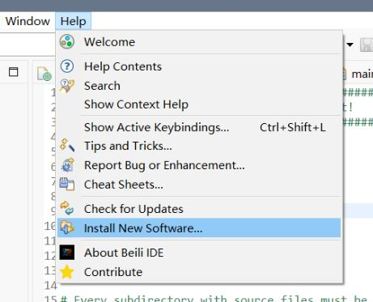
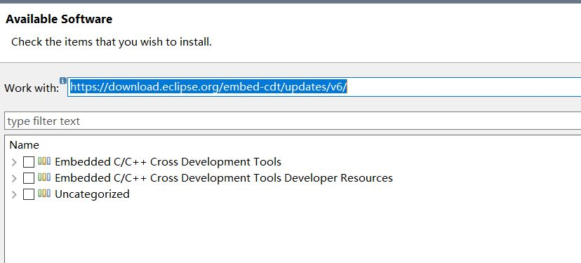
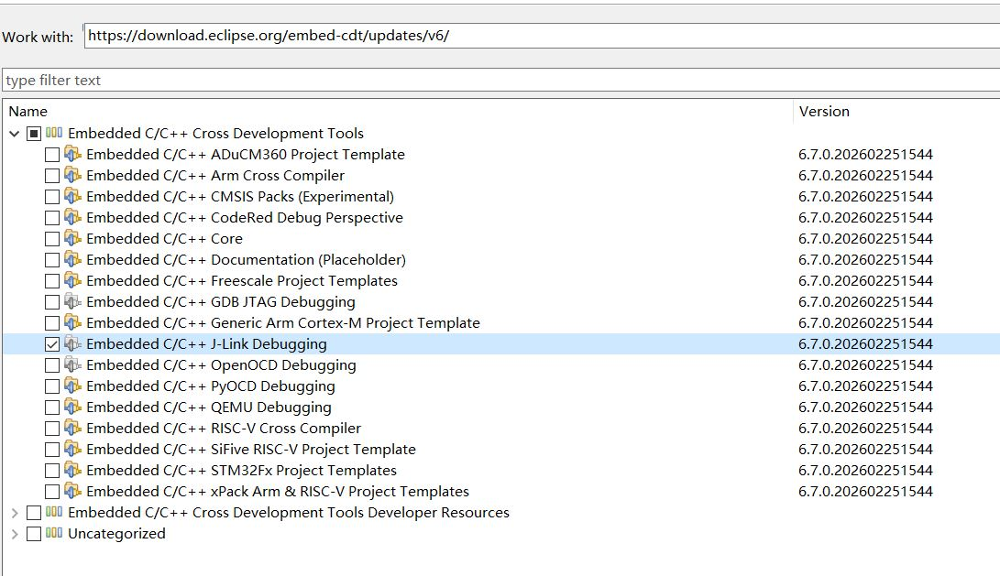
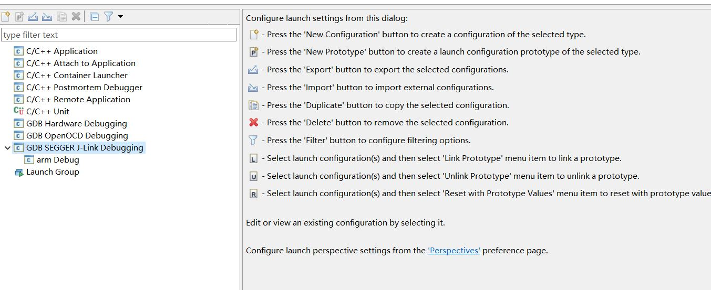
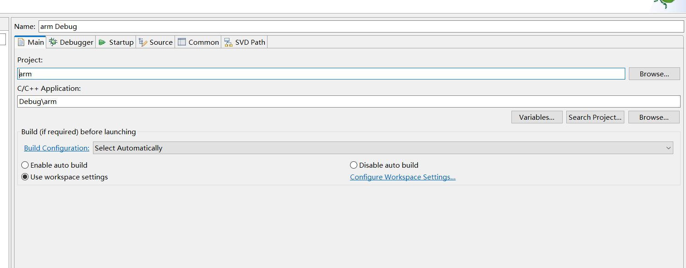
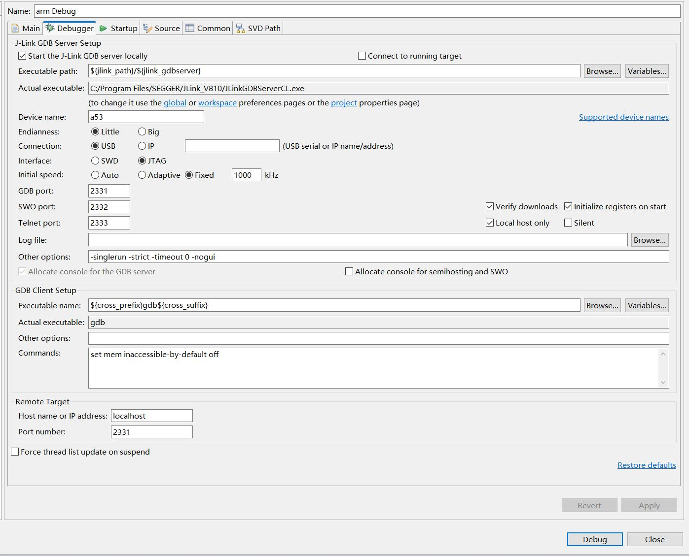
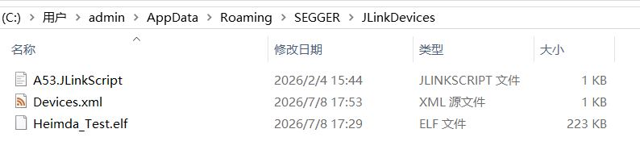

在Eclipse中安装Jlink Debugging插件，实现使用jlink debug的简易操作

# 安装教程  
- Help --> Install New Software  


- 在work with中填入插件地址：https://download.eclipse.org/embed-cdt/updates/v6/


- 在Embedded C/C++ Cross Development Tools选项下选择Jlink Debugging插件，**不需要的插件尽量不要安装**，减少下载时间

- 点击NEXT进行安装，跟随指引安装即可

# 安装教程（本地版，jar包复制）
使用联网安装，比较耗时。可以将需要的jar包下载到本地，复制到eclipse的安装目录下。便于多台设备安装操作

# 使用教程  
安装Jlink Debugging插件后，在Debug Config选项卡中会出现GDB SEGGER J-Link Debugging选项
1. 新建GDB SEGGER J-Link Debugging配置  


2. 各配置选项简要说明  
    - Main  
        1. Project：选择一个工程
        2. C/C++ Application：选择一个应用(xxx.elf);不选时可能会报错，无法启动debug，推荐选择
        3. 可以选择debug前自动编译，或者关闭自动编译
        
    - Debugger  
        1. J-Link GDB Server Setup
            - 注意Actual executable的路径，一定要指向实际的JLinkGDBServerCL.exe的路径
            - Device Name必须指定，**在添加自定义设备后**，可使用自定义的设备名称
            - 其它选项自行注意
        2. GDB Clint Setup
            - 注意Actual executable的路径，指向对应的gdb
        

    - 其它选项不再说明

# Jlink自定义设备  
实现参考[J-Link_Device_Support_Kit](https://kb.segger.com/J-Link_Device_Support_Kit)

1. 文件等存放路径 C:\Users\<USER>\AppData\Roaming\SEGGER\JLinkDevices\
当C:\Users\<USER>\AppData\Roaming\SEGGER目录下没有JLinkDevices目录时建立目录即可

2. 在JLinkDevices下建立Devices.xml文件，示例如下
```
<Database>
  <Device>
    <ChipInfo Vendor="SEGGER" Name="SEGGER_Device0" Core="JLINK_CORE_CORTEX_M0"/>
  </Device>
  <Device>
    <ChipInfo Vendor="SEGGER" Name="SEGGER_Device1" Core="JLINK_CORE_CORTEX_M4"/>
  </Device>
</Database>
```

3. 当需要J-Link script file时，在xml中指定(JLinkScriptFile="SEGGER/Example.jlinkscript")，示例如下
```
<Database>
  <Device>
    <ChipInfo Vendor="SEGGER" Name="SEGGER_Device0" Core="JLINK_CORE_CORTEX_M0" JLinkScriptFile="SEGGER/Example.jlinkscript"/>
  </Device>
</Database>
```

4. 指定flash信息和对应的烧录算法，示例如下
```
<Database>
  <Device>
    <ChipInfo Vendor="SEGGER" Name="SEGGER_Device0" WorkRAMAddr="0x20000000" WorkRAMSize="0x8000" Core="JLINK_CORE_CORTEX_M4" />
    <FlashBankInfo Name="Internal code flash" BaseAddr="0x08000000" AlwaysPresent="1" >
      <LoaderInfo Name="Default" MaxSize="0x80000" Loader="Flashloader_Device0_InternalCodeFlash.elf" LoaderType="FLASH_ALGO_TYPE_OPEN" />
    </FlashBankInfo>
  </Device>
</Database>
```

5. 示例
```
<Database>
  <Device>
    <ChipInfo Vendor="Heimda" Name="Heimda" WorkRAMAddr="0x2000000" WorkRAMSize="0x100000" Core="JLINK_CORE_CORTEX_A53" JLinkScriptFile="A53.jlinkscript" />
    <FlashBankInfo Name="AT25DQ041" BaseAddr="0x00000000" AlwaysPresent="1" >
      <LoaderInfo Name="SPI0 FLASH" MaxSize="0x100000" Loader="Heimda_Test.elf" LoaderType="FLASH_ALGO_TYPE_OPEN" />
    </FlashBankInfo>

    <FlashBankInfo Name="AT25DQ041" BaseAddr="0x00000000" AlwaysPresent="1" >
      <LoaderInfo Name="SPI1 FLASH" MaxSize="0x100000" Loader="Heimda_Test.elf" LoaderType="FLASH_ALGO_TYPE_OPEN" />
    </FlashBankInfo>
  </Device>
</Database>
```



# J-Link script file
当使用自定义设备时，一般需要建立J-Link script file，以heimda a53 core0为例
- 指定cpu类型
- 指定CoreBaseAddr
- 指定CTICoreBaseAddr
- 建立文件A53.JLinkScript，放入以下内容即可
```text
int ConfigTargetSettings(void) {
  
  JLINK_ExecCommand("JLINK_CPU = CORTEX_A53;");
  JLINK_ExecCommand("CORESIGHT_SetCoreBaseAddr = 0x80010000");
  JLINK_ExecCommand("CORESIGHT_SetCTICoreBaseAddr = 0x80020000");

  return 0;
}
```


