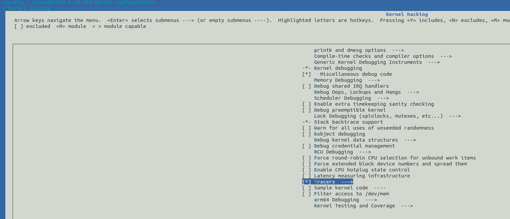
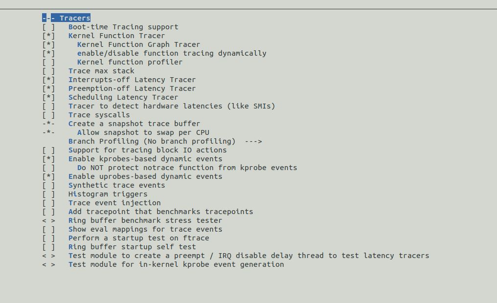

# 环境
- linux：5.10.227  
- CPU：arm cortex-a53 四核1.2GHz

# 现象
- 在应用中使用串口接收数据时，串口丢失数据。使用ioctl读取TIOCGICOUNT，确认是硬件fifo溢出
```c
#include <linux/serial.h>
#include <sys/ioctl.h>
#include <fcntl.h>
#include <stdio.h>
#include <unistd.h>

void uart_flag_read(void)
{
	int fd = open("/dev/ttyAMA0", O_RDWR | O_NOCTTY);
	struct serial_icounter_struct icount;

	if (ioctl(fd, TIOCGICOUNT, &icount) == 0) {
		printf("rx: %d\n", icount.rx);
		printf("tx: %d\n", icount.tx);
		printf("overrun: %d\n", icount.overrun);
		printf("buf_overrun: %d\n", icount.buf_overrun);
		printf("frame: %d\n", icount.frame);
		printf("brk: %d\n", icount.brk);
	}

	close(fd);
}
```

- 使用命令查看中断，可以看到所有的外部中断都在core0上，此时认为linux下外部中断会自动路由给所有core，目前仅单core处理所有外部中断。认为单core有能力处理所有外部中断
```bash
# cat /proc/interrupts
           CPU0       CPU1       CPU2       CPU3
 11:      62299      26961      31349      28279     GICv2  30 Level     arch_timer
 14:          0          0          0          0     GICv2  23 Level     arm-pmu
 15:          0          0          0          0     GICv2  57 Level     heimda_gpio_irq
 16:          0          0          0          0     GICv2  58 Level     heimda_gpio_irq
 17:        235          0          0          0     GICv2  39 Level     40003000.dma-controller
 23:         42          0          0          0     GICv2  51 Level     uart-pl011
 24:          3          0          0          0     GICv2  59 Level     4010b000.i2c
 25:          3          0          0          0     GICv2  60 Level     4010c000.i2c
 26:         40          0          0          0     GICv2  54 Level     50000000.spi
 27:         40          0          0          0     GICv2  55 Level     60000000.spi
 28:         40          0          0          0     GICv2  56 Level     70000000.spi
 29:          0          0          0          0     GICv2  52 Level     pl022
 30:          0          0          0          0     GICv2  53 Level     pl022
 31:      59875          0          0          0     GICv2  63 Level     eth0
 34:          0          0          0          0     GICv2  38 Level     cmdr_s2m_irq
IPI0:     12651      38691      33360      22264       Rescheduling interrupts
IPI1:      2118       3460       2681        373       Function call interrupts
IPI2:         0          0          0          0       CPU stop interrupts
IPI3:         0          0          0          0       CPU stop (for crash dump) interrupts
IPI4:         0          0          0          0       Timer broadcast interrupts
IPI5:         0          0          0          0       IRQ work interrupts
IPI6:         0          0          0          0       CPU wake-up interrupts
Err:          0
#
```
- 关闭应用中的遥测（串口发送）后，不会出现oe，怀疑串口发送导致串口接收不及时

- 对串口进行单独压力测试。运行单核linux。三个串口同时收发数据，一个进程跑while(1)（目的是尽量让cpu满负载）;没有出现fifo溢出。

- 后续查看中断路由情况，确认linux只将中断路由给core0。上面的猜测推断被推翻，是因为中断仅被路由至core0，所以只有core0处理外部中断。
```bash
# cat /proc/irq/23/effective_affinity
1
# cat /proc/irq/23/effective_affinity_list
0
# cat /proc/irq/23/smp_affinity
f
# cat /proc/irq/23/smp_affinity_list
0-3
```
- 将问题方向大致定位为，单core中断响应不及时，导致fifo溢出

# 如何定位问题点
- 疑点方向
    1. 其它中断处理时间长，导致串口中断响应不及时？
    2. 系统中中断被关闭，导致串口中断响应不及时？

- 定位工具ftrace
    开启内核中的ftrace功能
    1. CONFIG_FTRACE
    2. CONFIG_FUNCTION_TRACER
    3. CONFIG_IRQSOFF_TRACER
    4. CONFIG_DEBUG_FS  

- meunconfig如下：
    
    

- 工具使用，中断跟踪  
可以指定过滤，仅跟踪想要的内容
```bash
# mount -t debugfs none /sys/kernel/debug
# cd /sys/kernel/debug/tracing/

# echo 'irq:*' > set_event  启用 IRQ 相关事件，激活跟踪点
# echo 1 >tracing_on    开启跟踪
# echo 0 >tracing_on    关闭跟踪
# cat trace             查看跟踪结果

# tracer: nop
#
# entries-in-buffer/entries-written: 20896/20896   #P:4
#
#                                _-----=> irqs-off
#                               / _----=> need-resched
#                              | / _---=> hardirq/softirq
#                              || / _--=> preempt-depth
#                              ||| /     delay
#           TASK-PID     CPU#  ||||   TIMESTAMP  FUNCTION
#              | |         |   ||||      |         |
          <idle>-0       [002] dnh1   308.051061: irq_handler_entry: irq=1 name=IPI
          <idle>-0       [002] dNh1   308.051067: irq_handler_exit: irq=1 ret=handled
          <idle>-0       [000] dnh1   308.051087: irq_handler_entry: irq=1 name=IPI
          <idle>-0       [000] dNh1   308.051089: irq_handler_exit: irq=1 ret=handled
          <idle>-0       [000] d.h1   308.052228: irq_handler_entry: irq=31 name=eth0
          <idle>-0       [000] d.h1   308.052234: softirq_raise: vec=3 [action=NET_RX]
          <idle>-0       [000] d.h1   308.052235: irq_handler_exit: irq=31 ret=handled
          <idle>-0       [000] ..s1   308.052237: softirq_entry: vec=3 [action=NET_RX]
          <idle>-0       [000] ..s1   308.052258: softirq_exit: vec=3 [action=NET_RX]
          <idle>-0       [000] d.h1   308.052774: irq_handler_entry: irq=11 name=arch_timer
          <idle>-0       [002] d.h1   308.052774: irq_handler_entry: irq=11 name=arch_timer
          <idle>-0       [003] d.h1   308.052775: irq_handler_entry: irq=11 name=arch_timer
          <idle>-0       [002] d.h1   308.052777: softirq_raise: vec=1 [action=TIMER]
          <idle>-0       [000] d.h1   308.052778: softirq_raise: vec=1 [action=TIMER]
          <idle>-0       [002] d.h1   308.052778: softirq_raise: vec=9 [action=RCU]
          <idle>-0       [000] d.h1   308.052779: softirq_raise: vec=9 [action=RCU]
          <idle>-0       [003] d.h1   308.052779: softirq_raise: vec=9 [action=RCU]
          <idle>-0       [002] d.h1   308.052780: softirq_raise: vec=7 [action=SCHED]
          <idle>-0       [002] d.h1   308.052782: irq_handler_exit: irq=11 ret=handled
          <idle>-0       [003] d.h1   308.052782: irq_handler_exit: irq=11 ret=handled
          <idle>-0       [000] d.h1   308.052782: irq_handler_exit: irq=11 ret=handled
          <idle>-0       [002] ..s1   308.052784: softirq_entry: vec=1 [action=TIMER]
          <idle>-0       [000] ..s1   308.052785: softirq_entry: vec=1 [action=TIMER]
          <idle>-0       [003] ..s1   308.052785: softirq_entry: vec=9 [action=RCU]
          <idle>-0       [000] ..s1   308.052787: softirq_exit: vec=1 [action=TIMER]
          <idle>-0       [003] ..s1   308.052788: softirq_exit: vec=9 [action=RCU]
          <idle>-0       [000] ..s1   308.052788: softirq_entry: vec=9 [action=RCU]
          <idle>-0       [000] ..s1   308.052794: softirq_exit: vec=9 [action=RCU]
·····
内容过多不展示
```

- irqsoff，关闭中断时间跟踪
    1. 中断关闭时间，即为中断的延时处理时间？
    2. 通过中断关闭时间，判断是否超过接收中断延迟处理的余量，进行后续判断
```bash
# echo 0 > tracing_max_latency
# echo 100 > tracing_thresh
# echo irqoff > current_tracer
sh: write error: Invalid argument
# echo irqsoff > current_tracer
# echo 1 > tracing_on
# echo 0 > tracing_on
# cat trace
# tracer: irqsoff
#
# irqsoff latency trace v1.1.5 on 5.10.227-gc16f9fdd961d-dirty
# --------------------------------------------------------------------
# latency: 102 us, #111/111, CPU#0 | (M:preempt VP:0, KP:0, SP:0 HP:0 #P:4)
#    -----------------
#    | task: swapper/0-0 (uid:0 nice:0 policy:0 rt_prio:0)
#    -----------------
#  => started at: enter_el1_irq_or_nmi
#  => ended at:   exit_el1_irq_or_nmi
#
#
#                    _------=> CPU#
#                   / _-----=> irqs-off
#                  | / _----=> need-resched
#                  || / _---=> hardirq/softirq
#                  ||| / _--=> preempt-depth
#                  |||| /     delay
#  cmd     pid     ||||| time  |   caller
#     \   /        |||||  \    |   /
  <idle>-0         0d..1    0us : enter_from_kernel_mode.isra.6 <-enter_el1_irq_or_nmi
  <idle>-0         0d..2    1us : efi_header_end <-el1_irq

    ...

  <idle>-0         0d.h6   84us : hrtick_update <-enqueue_task_fair
  <idle>-0         0d.h6   85us : ttwu_do_wakeup <-ttwu_do_activate
  <idle>-0         0d.h6   86us : check_preempt_curr <-ttwu_do_wakeup
  <idle>-0         0d.h6   87us : resched_curr <-check_preempt_curr
  <idle>-0         0dNh6   88us : _raw_spin_unlock <-try_to_wake_up
  <idle>-0         0dNh6   89us : preempt_count_sub <-_raw_spin_unlock
  <idle>-0         0dNh5   90us : _raw_spin_unlock_irqrestore <-try_to_wake_up
  <idle>-0         0dNh5   91us : preempt_count_sub <-_raw_spin_unlock_irqrestore
  <idle>-0         0dNh4   92us : preempt_count_sub <-try_to_wake_up
  <idle>-0         0dNh3   92us : _raw_spin_unlock <-__queue_work
  <idle>-0         0dNh3   93us : preempt_count_sub <-_raw_spin_unlock
  <idle>-0         0dNh2   94us : __rcu_read_unlock <-__queue_work
  <idle>-0         0dNh3   95us : __traceiter_irq_handler_exit <-handle_percpu_devid_fasteoi_ipi
  <idle>-0         0dNh1   96us : irq_handler_exit: irq=6 ret=handled
  <idle>-0         0dNh2   97us : irq_exit <-__handle_domain_irq
  <idle>-0         0dNh2   98us : irqtime_account_irq <-irq_exit
  <idle>-0         0dNh2   99us : preempt_count_sub <-irq_exit
  <idle>-0         0dN.2  100us : idle_cpu <-irq_exit
  <idle>-0         0dN.1  102us : exit_to_kernel_mode.isra.7 <-exit_el1_irq_or_nmi
  <idle>-0         0dN.1  103us : tracer_hardirqs_on <-exit_el1_irq_or_nmi
  <idle>-0         0dN.1  107us : <stack trace>
 => exit_el1_irq_or_nmi
 => el1_irq
 => arch_cpu_idle
 => default_idle_call
 => do_idle
 => cpu_startup_entry
 => rest_init
 => arch_call_rest_init
 => start_kernel
#

```
- trace分析
    1. 可以通过中断的进入和退出时间，得出中断的执行时间
    2. 怎么利用其它工具完成中断时间的自动计算？

- trace cmd，应当可以实现中断时间统计
    1. trace-cmd下载编译未完成，下载耗时


# 问题定位计划
- 需要环境复现oe
- 在该环境中运行ftrace，可能存在信息覆盖问题
- 分析trace信息，定位中断消耗时间

# 常用命令
```
#清空跟踪事件
echo > set_event

#仅跟踪硬件中断进出
echo 'irq:irq_handler_entry irq:irq_handler_exit' > set_event

#跟踪所有
echo 'irq:*' > set_event

#使用过滤器，跟踪指定中断
echo  "irq==22" > events/irq/irq_handler_exit/filter
echo  "irq==22" > events/irq/irq_handler_entry/filter

#启动，关闭跟踪
echo 1 > tracing_on
echo 0 > tracing_on

#查看，清空跟踪log
cat trace
echo > trace

```

# 降频复现
- 将cpu主频降低至120MHz
- 运行串口测试
    1. 进程1进行串口1收发
    2. 进程2进行串口2收发
- 串口2出现oe
- 基本断定为中断处理不及时，导致oe

# 解决方法
- 修改串口中断亲和性，将中断路由至其它core
- 已解决串口dma功能无法使用的问题（高位地址映射错误），开启串口dma功能，缓解中断压力
